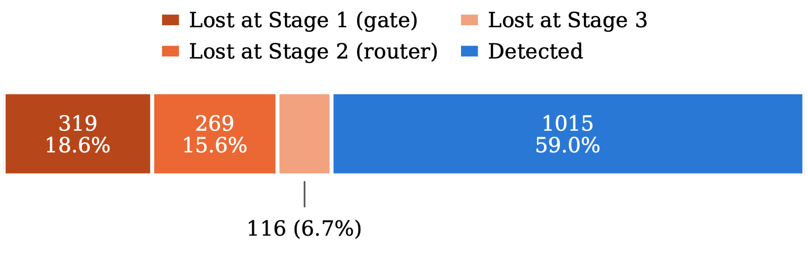
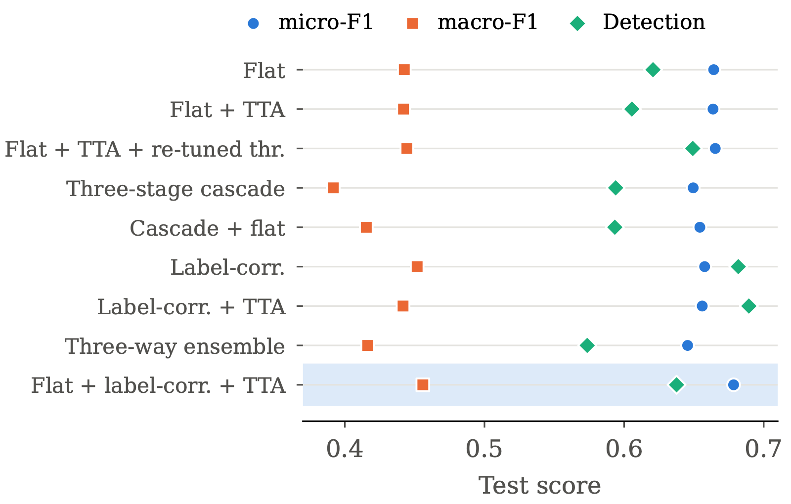
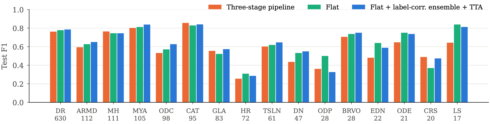

**Preprint** on arXiv (October 2026), with the code and the test-set predictions public.
Md Asif Uddin, Jannatul Ferdous, Asif Islam, Zobaer Mahmud Zisan, Promit Ghosh, Shah Ahafik Arman, Niloy Farhan and Rafeed Rahman, Department of Computer Science and Engineering, Brac University.
[Preprint, arXiv:2610.23747](https://arxiv.org/abs/2610.23747) · [Code and test-set predictions](https://github.com/asifuddin01/Beyond-Multi-Stage-Pipelines)

## The question

One eye can show diabetic retinopathy, laser scars and media haze at the same time. Screening for retinal disease is a multi-label problem, and its tail holds dozens of conditions with only a handful of examples each.

Clinical triage suggests a staged design:

1. A screening gate sends healthy eyes home.
2. A router assigns the rest to broad disease groups.
3. Small group-specific classifiers make the fine-grained call.

Each step is an easier problem, and every failure can be pinned to a stage. A flat model instead predicts every disease from one shared representation and makes no early, irreversible decision.

Earlier multi-disease studies compare models that differ in backbone, preprocessing and label set all at once, so the effect of the architecture cannot be separated from everything else. We held everything fixed except the architecture and asked one question: **does the hierarchy earn its complexity?**

## The data

We merged three public datasets, RFMiD 1.0, RFMiD 2.0 and ODIR-5K, into 12,652 images. Each source keeps its official split: 8,520 for training, 1,678 for validation and 2,454 for testing. The test split was sealed and read once, for the final evaluation.

The label space has 39 scored targets:

- 38 named diseases with at least six training images, organised into six clinical groups: vascular, exudative, optic disc, structural, media and inflammatory;
- one pooled target for the 21 ultra-rare classes with five or fewer training images, which is detected but not sub-classified.

The tail is extreme. Diabetic retinopathy has 2,219 training images, while 16 of the 39 targets have fewer than ten positives in the test set.

## The four systems

All of them use the same Swin-V2-B backbone at 384 pixels, the same preprocessing, the same loss (binary cross-entropy with a per-class weight for positives), the same optimiser, and decision thresholds tuned per class on validation data.

- **A. Three-stage cascade (eight models).** A healthy/unhealthy gate, a router over the six groups and the rare pool, and six group classifiers of 2 to 9 diseases each. Gating is hard, as in a deployed system: an image rejected upstream gets probability zero for every disease downstream.
- **B. Flat classifier.** One linear head over the pooled feature, with 39 independent sigmoids.
- **C. Label-correlation model.** The linear head is replaced by 39 learned label queries and a two-layer transformer decoder. Self-attention lets the labels exchange evidence, and cross-attention lets each label look at the parts of the image that matter for it. The training set holds 204 distinct pairs of co-occurring diseases, which independent sigmoids cannot represent.
- **D. Best configuration.** B and C averaged over four flipped views of each image, blended 0.45 / 0.55, with per-class thresholds re-tuned on the blended validation outputs.

## Where the cascade loses disease

We traced every true disease instance in the test split to the stage that lost it.

Of 1,719 instances, the two coarse gates lost 34.2%: 18.6% at the screening gate and 15.6% at the router. The fine-grained classifiers lost only 6.7%. The gate sent 297 of 1,449 diseased test images home as healthy, and every disease on those images was lost with them. Even at its most liberal threshold, the gate still missed about one diseased eye in ten on validation data.

**Hard zeros break rank metrics.** The cascade's macro-AUC is 0.747, although every group output and every group classifier scores above 0.90 on validation. A true case thrown out at a gate gets a score of exactly zero, so it ranks below every healthy case with a small non-zero score. A gated system should be compared on its decisions (F1, exact match, detection), not on AUC.

## Does the hierarchy earn its complexity?

| System | Exact match | Micro-F1 | Macro-F1 | Detection |
|---|---|---|---|---|
| Flat | 0.679 | 0.664 | 0.443 | 0.621 |
| Three-stage cascade | 0.687 | 0.649 | 0.392 | 0.594 |
| Label-correlation + TTA | 0.676 | 0.656 | 0.442 | **0.689** |
| Flat + label-correlation + TTA | **0.694** | **0.678** | **0.456** | 0.638 |

The cascade wins narrowly on the two image-level measures, exact match and Jaccard, because its gate passes healthy eyes cleanly. It loses on every measure that counts diseases: micro-F1, macro-F1 and detection. The gap is widest on macro-F1, which weights rare diseases equally. Eight models to train, calibrate and maintain buy failures that are easy to locate, not better accuracy.

## What each technique adds

- **Test-time augmentation needs new thresholds.** Averaged naively over four views, it slightly lowered detection, because the averaged probabilities no longer matched thresholds tuned on single views. With thresholds re-tuned on validation, detection rose by 0.029.
- **Label correlation is the largest single gain.** Changing only the head raised detection from 0.621 to 0.682, and to 0.689 with test-time augmentation, the highest in the study. Macro-AUC rose from 0.943 to 0.966. Evidence of diabetic retinopathy makes exudates and cotton-wool spots easier to find.
- **Ensembles help only between continuous outputs.** Blending the cautious flat model with the recall-oriented label-correlation model was best on six of eight metrics. Averaging the cascade with the flat model made it worse than the flat model alone, on micro-F1 (0.654 against 0.665) and on detection (0.593 against 0.649), and a three-way ensemble was worse still. The cascade's zeros drag its partners down on exactly the images its gates threw away. Gated pipelines should not be members of probability-averaging ensembles.

That leaves two operating points. For population screening, where a missed disease costs more than a false alarm, the label-correlation model with test-time augmentation finds the most disease. For decision support, the ensemble gives the best exact match and F1.

## A shortcut in pooled data

In the media group, nearly all media-haze images come from RFMiD and nearly all cataract images from ODIR. A model trained on positives alone scored a validation AUC of 1.000 by recognising which camera took the photograph.

We added negatives sampled per source, in proportion to each source's positives, so that the rate of positives is equal within every source. The corrected model scores 0.983 macro-AUC. Measured within single sources, where the camera cannot give the answer away, it reaches 0.987 for cataract in ODIR and 0.954 for media haze in RFMiD 1.0.

The perfect score was invisible in the pooled validation numbers. Whenever a label is concentrated in one source, results should be reported within each source.

## Disease by disease

The best configuration leads or ties on most frequent diseases. It passes an F1 of 0.80 on cataract (0.840), myopia (0.838) and laser scars (0.812), and reaches 0.785 on diabetic retinopathy. The cascade stays competitive on cataract, media haze and chorioretinitis, where its specialists see a narrower problem.

Hypertensive retinopathy (0.286) and macular scar (0.154) remain hard, and six targets with seven or fewer test positives are never correctly detected. All models score best on ODIR-5K, whose eight categories are coarse, and worst on RFMiD 2.0, whose 172 test images carry the richest and rarest label sets.

## Against recent studies

Our 39 targets match no published label set, so we compared on definition-matched subsets: for each study, the classes defined the same way, with our metrics recomputed on exactly those classes from the released predictions.

| Study | Shared classes | Macro-F1 (ours / theirs) | Micro-F1 (ours / theirs) |
|---|---|---|---|
| C-Tran, MuReD | 15 | 0.657 / 0.638 | not reported |
| Dual CNN, MuReD | 15 | 0.657 / 0.403 | 0.726 / 0.548 |
| ASL cascade, RFMiD | 26 | 0.478 / 0.476 | 0.702 / 0.626 |
| Twelve-model benchmark, RFMiD | 26 | 0.478 / 0.340 | 0.702 / 0.509 |

We match or exceed every comparator on macro- and micro-F1 wherever they are reported. Against the asymmetric-loss cascade, macro-F1 and macro-AP are essentially tied. Against C-Tran, the lead comes from low-support classes, such as optic disc pallor, which C-Tran never detects, and laser scars. C-Tran leads on frequent, strongly co-occurring classes such as tessellation and optic disc edema.

The comparators use different test sets, and one is a preprint that has not been peer reviewed, so these numbers place the model among recent work rather than rank it.

## Limitations

- The ultra-rare classes stay unsolved across every architecture and loss we tried, which points to too little data rather than too small a model.
- Sixteen of the 39 targets have fewer than ten test positives, so their per-class figures are unstable.
- ODIR-5K dominates the merged test split, so the overall figures are not directly comparable with single-dataset studies.
- The disease groups follow the literature but were not reviewed by an ophthalmologist.
- The cascade's parts were tuned more (losses, pooling, samplers) than the flat and label-correlation models, which were each trained once. That favours the cascade.
- Ensemble weights and thresholds were tuned on the same validation split that selected the checkpoints, so a small optimistic bias cannot be ruled out.
- It is a research prototype, not a medical device.

## Reproducibility

The [repository](https://github.com/asifuddin01/Beyond-Multi-Stage-Pipelines) holds:

- the shared code for labels, data, models, losses, training, metrics and inference;
- seven notebooks, in run order, from the screening gate to the final ablation;
- the test-set predictions of the best configuration, as decisions and as probabilities;
- a script that re-scores those predictions against the test labels, including the subsets used for the comparison with recent studies;
- the nine-row ablation table and the paper's source.

The datasets are public and are not redistributed; the repository describes how to merge them.
